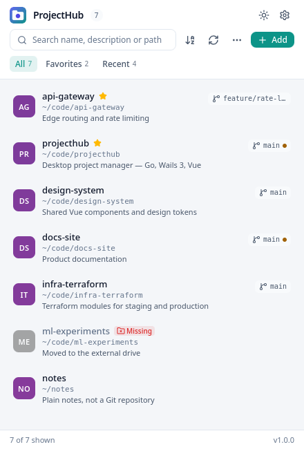
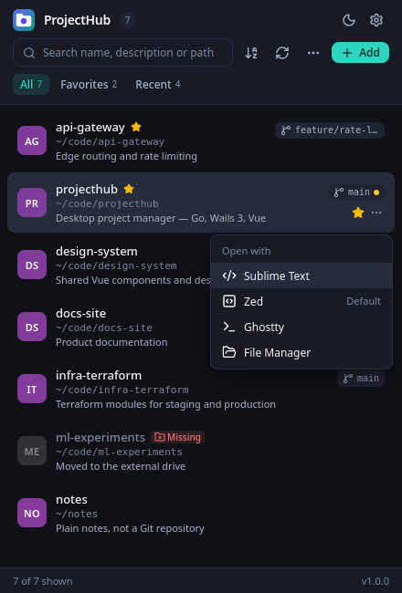
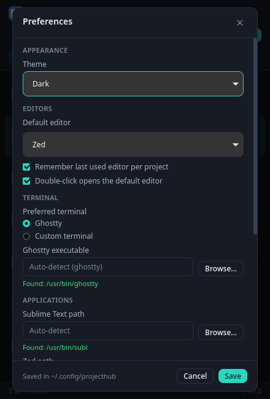

# ProjectHub

**A lightweight, local-first project launcher for Linux developers.**

ProjectHub keeps a list of the project directories on your machine and opens any of them in one click — in your code editor, in a terminal, or in the file manager. It shows the Git branch and uncommitted changes of every project, lives in the system tray, and stores everything in two plain JSON files. No accounts, no cloud sync, no telemetry.

It is inspired by the *Projects* view of JetBrains Toolbox, but is an independent, editor-agnostic tool built for the GNOME desktop with Go, [Wails 3](https://v3.wails.io/) and Vue 3.

<p align="center">
  
</p>

## Why ProjectHub?

If you jump between many repositories during the day, opening a project usually means finding it in a terminal or file dialog first. ProjectHub turns that into a searchable list that is always one click (or one tray menu) away, and it works with the tools you already use instead of replacing them.

## Features

- **Project catalog** — add, edit and remove local directories with a name, description, favorite flag and per-project default editor. Removing a project never touches its files.
- **Open in one click** — Zed or Sublime Text, Ghostty or any other terminal, or the system file manager. Double-click opens the project's editor (can be turned off in Preferences); a single click shows *Open with*.
- **Favorites, Recent and search** — favorites are pinned to the top, the Recent tab lists the last opened projects, and search matches names, descriptions and paths. Sort by name or by last opened.
- **Git at a glance** — branch (or detached commit), a dot for uncommitted tracked changes, ahead/behind counts in the tooltip, and a clear flag for directories that no longer exist. Inspection is read-only and never runs repository hooks or filters.
- **System tray** — open ProjectHub, jump straight into one of the eight most recently opened projects, open Settings, or quit. Closing the window keeps ProjectHub in the tray (configurable).
- **Single instance** — starting ProjectHub again brings the existing window back, with its state intact.
- **Drag & drop** — drop a folder on the window to add it; drop several to add them all at once.
- **Import / export** — move your catalog between machines as JSON, with a preview and a merge or replace (with backup) choice.
- **Keyboard friendly** — `Ctrl+F` to search, arrow keys to move, `Enter` to open, `F2` to edit, and more.
- **Light, dark or system theme**, remembered window size, optional always-on-top.
- **Native Ubuntu integration** — application menu entry, icon, GNOME search, Ubuntu Dock pinning, Wayland and X11.

## Screenshots

| Project list (light theme) | Open with (dark theme) | Preferences |
| :---: | :---: | :---: |
|  |  |  |
| Favorites first, Git branch and changes, a flagged missing directory | One click opens a project in an editor, terminal or file manager | Editors, terminal, file manager, Git and window options |

Captured from ProjectHub 1.0.0 on Ubuntu 24.04 (GNOME) with sample projects in a throwaway home directory.

## Installation

ProjectHub is distributed as a Debian package for Ubuntu (amd64).

1. Download `projecthub_<version>_amd64.deb` and `SHA256SUMS` from the [latest release](https://github.com/semelyanov86/ProjectHub/releases/latest).
2. Verify and install it with apt, which also installs the required libraries:

   ```bash
   sha256sum --check --ignore-missing SHA256SUMS
   sudo apt install ./projecthub_*_amd64.deb
   ```

3. Start **ProjectHub** from the applications menu (search for "ProjectHub"), or run `projecthub` in a terminal. Right-click the running app in the Ubuntu Dock and choose *Pin to Dash* to keep it there.

To remove it:

```bash
sudo apt remove projecthub
```

Removing the package does not delete your projects and settings in `~/.config/projecthub`; delete that directory yourself if you no longer need it.

You can also [build the package from source](#development).

## Requirements

| | |
| --- | --- |
| Operating system | Ubuntu 24.04 LTS or Ubuntu 26.04 LTS, amd64 |
| Desktop | GNOME on Wayland or X11 (other desktops work, but are not tested) |
| Runtime libraries | GTK 4 (`libgtk-4-1`) and WebKitGTK 6.0 (`libwebkitgtk-6.0-4`, `libjavascriptcoregtk-6.0-1`), `libsoup-3.0-0`, `libglib2.0-0t64`, `libx11-6` — installed automatically by apt |
| Recommended | `git` for the branch and changes indicators |

ProjectHub launches applications you install separately. All of them are **optional**; menu entries for missing applications are disabled with an explanation:

- [Zed](https://zed.dev/) (`zed` or `zeditor`) and [Sublime Text](https://www.sublimetext.com/) (`subl`)
- [Ghostty](https://ghostty.org/) 1.3 or later, or any terminal you configure (presets for Ptyxis, GNOME Terminal, kitty, Alacritty, WezTerm and Konsole)
- The file manager registered for directories (opened with `gio open`, then `xdg-open`)

The tray icon needs a StatusNotifierItem host. Ubuntu's default session provides one through the preinstalled *Ubuntu AppIndicators* extension; stock GNOME does not show tray icons. Without a tray ProjectHub works normally and closing the window quits it.

## Usage

### Adding projects

Click **Add** and pick a directory in the folder picker. ProjectHub suggests a name from the directory and shows its Git state; add an optional description, mark it as a favorite, or choose a default editor for this project, then save. You can also drag folders from the file manager onto the window: one folder opens the Add dialog pre-filled, several folders are added immediately (duplicates and non-directories are skipped and reported).

Edit a project with **Edit…** in its context menu (right-click, the **⋯** button or `F2`). **Remove** asks for confirmation and only unregisters the project.

### Choosing editors

ProjectHub supports **Zed** (the default) and **Sublime Text**. The editor used by a double-click, `Ctrl+Enter` or the tray menu is chosen in this order:

1. the project's own default editor, if you set one;
2. the editor you last opened the project with, when *Remember last used editor* is enabled (default);
3. the global default editor from Preferences.

Single-click a project (or press `Enter`) to choose a different application from *Open with*.

### Opening a terminal

*Open with → Ghostty* opens a new Ghostty window in the project directory (`ghostty +new-window --working-directory=<dir>`, falling back to a separate Ghostty instance). To use another terminal, choose **Preferences → Terminal → Custom terminal**, pick a preset or enter an executable, and list its arguments one per line. `{path}` is replaced with the project directory; arguments are passed as-is, never through a shell.

### Opening the file manager

*Open with → File Manager* opens the directory in your default file manager. To always use a specific one, choose **Preferences → File manager → Custom** and enter its executable; it receives the directory as its only argument.

### Favorites

Click the star on a project row (or use the context menu) to mark it as a favorite. Favorites are pinned to the top of the **All** tab and listed on their own in the **Favorites** tab.

### Search

Type in the search field (`Ctrl+F`) to filter by name, description or path. Press `↓` to move into the results and `Esc` to clear the search.

### Git integration

Each project in a Git repository shows its branch, or a short commit hash for a detached HEAD. A filled dot means tracked files have uncommitted changes; a hollow ring means the result may be inaccurate because a repository-defined filter was disabled for safety. The tooltip shows ahead/behind counts relative to what your local repository knows (ProjectHub never fetches). Inspection errors such as timeouts appear as a **Git error** badge. Git is optional: without it everything else keeps working.

Status is refreshed on startup, after changes to the catalog, with the refresh button, and when the window regains focus after more than a minute.

### System tray

The tray menu offers **Open ProjectHub**, your **recent projects** (opened in their effective editor), **Settings…** and **Quit ProjectHub**. By default, closing the window hides ProjectHub to the tray; to quit instead, choose **Preferences → Window → When the window is closed → Quit ProjectHub**. If no tray is available, closing the window always quits.

### Import and export

Use **Export projects…** and **Import projects…** in the toolbar's **⋯** menu. An import shows a preview of new, duplicate and missing directories first. In both modes, projects whose directory does not exist on this computer are skipped. **Merge** adds new projects, keeps existing ones and skips paths that are already registered; **Replace** swaps the whole catalog after confirmation and saves a backup of the previous `projects.json` next to it (`projects.json.bak-<UTC timestamp>`). Imports accept files up to 10 MiB and 10,000 projects; paths stay local, no project files are copied.

### Keyboard shortcuts

| Shortcut | Action |
| --- | --- |
| `Ctrl+F` | Focus search |
| `↑` / `↓`, `Home` / `End` | Move through the project list |
| `Enter` / `Space` | Show *Open with* |
| `Ctrl+Enter` | Open in the effective editor |
| `Shift+F10` / Menu key | Context menu |
| `F2` | Edit the selected project |
| `Delete` | Remove the selected project (with confirmation) |
| `Esc` | Close a popup or dialog, or clear the search |

## Configuration

ProjectHub follows the [XDG Base Directory Specification](https://specifications.freedesktop.org/basedir-spec/latest/): its files live in `$XDG_CONFIG_HOME/projecthub/`, which is `~/.config/projecthub/` by default. Both files are created with defaults on the first launch, are readable only by you (mode `0600`) and are written atomically. A corrupted or unsupported file is reported and never overwritten.

Most options are available in **Preferences** (the gear icon). `settings.json` contains:

| Field | Default | Meaning |
| --- | --- | --- |
| `schemaVersion` | `2` | Settings format version |
| `defaultEditor` | `"zed"` | Global editor: `zed` or `sublime` |
| `rememberLastEditor` | `true` | Use each project's last used editor |
| `doubleClickOpensEditor` | `true` | Double-click opens the effective editor |
| `preferredTerminal` | `"ghostty"` | `ghostty` or `custom` |
| `customTerminal.executable` | `""` | Custom terminal executable |
| `customTerminal.args` | `[]` | Custom terminal arguments; `{path}` is the project directory |
| `preferredFileManager` | `"auto"` | `auto` (`gio open`, then `xdg-open`) or `custom` |
| `executables.zed` | `""` | Zed executable override; empty means auto-detect |
| `executables.sublime` | `""` | Sublime Text executable override; empty means auto-detect |
| `executables.ghostty` | `""` | Ghostty executable override; empty means auto-detect |
| `executables.fileManager` | `""` | File manager executable for `custom` mode |
| `theme` | `"system"` | `system`, `light` or `dark` |
| `showGitDirty` | `true` | Show the uncommitted-changes indicator |
| `projectSort` | `"name"` | `name` or `lastOpened` |
| `closeBehavior` | `"tray"` | `tray` (hide to the tray when one is available) or `quit` |
| `window.width`, `window.height` | `440`, `650` | Window size in pixels |
| `window.rememberSize` | `true` | Restore the last window size |
| `window.alwaysOnTop` | `false` | Keep the window above others |

`projects.json` holds `schemaVersion` and a `projects` array. Each project has an `id`, `name`, `description`, absolute `path`, `favorite`, `defaultEditor`, `lastUsedEditor`, `lastOpened`, `createdAt` and `updatedAt`.

### Custom executable paths

Executables are detected on `PATH` and in common install locations (`~/.local/bin`, `~/.local/zed.app/bin`, `~/bin`, `/usr/local/bin`, `/usr/bin`, `/opt/sublime_text`, `/snap/bin`). Desktop sessions often start applications without `~/.local/bin` on `PATH`, which is why these locations are probed. If an application is still not found, set its executable in Preferences (or **Browse…** for it). Use a bare command name or an absolute path, without arguments. A configured path is authoritative: if it is wrong, ProjectHub reports it instead of silently using another program.

Schema version 1 files written by pre-release builds are migrated in memory when loaded and saved as version 2 on the next change.

## Development

### Prerequisites

On Ubuntu 24.04 or newer:

```bash
sudo apt install build-essential pkg-config git libgtk-4-dev libwebkitgtk-6.0-dev \
  dpkg-dev desktop-file-utils appstream lintian
```

Then install Go 1.26+, Node.js 22+ (with npm), and the Go-based tools:

```bash
go install github.com/go-task/task/v3/cmd/task@v3.54.0
go install github.com/wailsapp/wails/v3/cmd/wails3@v3.1.0
go install github.com/golangci/golangci-lint/v2/cmd/golangci-lint@v2.15.0
export PATH="$(go env GOPATH)/bin:$PATH"   # put this first on PATH, e.g. in ~/.profile
```

Optionally install `govulncheck` for `task audit`: `go install golang.org/x/vuln/cmd/govulncheck@latest`.

### Build and run

```bash
git clone https://github.com/semelyanov86/ProjectHub.git
cd ProjectHub
task doctor   # check the toolchain and libraries
task dev      # run with hot reload
task test     # Go (with -race) and Vitest tests
task check    # version, formatting, linters, TypeScript, all tests — run before every PR
task build    # production binary in bin/projecthub
task deb      # dist/projecthub_<version>_amd64.deb, then verify it
```

Frontend dependencies are installed from `frontend/package-lock.json` with `npm ci` automatically.

### Tasks

| Task | Description |
| --- | --- |
| `task dev` | Run in Wails development mode with hot reload |
| `task build` | Build the production binary `bin/projecthub` |
| `task deb` | Build `dist/projecthub_<version>_<arch>.deb` and verify it (`deb:verify`) |
| `task deb:verify` | Check package metadata, files, permissions, dependencies (against `dpkg-shlibdeps`), desktop and AppStream files |
| `task deb:smoke` | Install the package in clean Ubuntu 24.04 and 26.04 containers and run GUI smoke tests (Docker) |
| `task install` | **Uses sudo.** Install the built `.deb` with apt, after asking for confirmation |
| `task uninstall` | **Uses sudo.** Remove the package with apt, after asking for confirmation |
| `task test` | Go unit tests with the race detector and the Vitest suite |
| `task test:coverage` | Tests with coverage reports |
| `task lint` | `go vet`, golangci-lint, `vue-tsc`, ESLint and shell syntax checks |
| `task format` | Format Go (gofumpt, goimports) and frontend (Prettier) code |
| `task check` | Everything CI runs before the build: version consistency, formatting, lint, tests |
| `task doctor` | Report missing tools and libraries, run `wails3 doctor` |
| `task version:check` | Verify that `VERSION` matches all release metadata |
| `task icons` | Re-render the PNG icons from `build/icons/*.svg` |
| `task audit` | `govulncheck` and `npm audit` |
| `task clean` | Remove `bin/`, `dist/`, generated bindings and frontend output |
| `task install:desktop` | Development helper: add `bin/projecthub` to your own application menu (no sudo) |
| `task uninstall:desktop` | Remove the menu entry and icons added by `task install:desktop` |

Only `task install` and `task uninstall` change the system, and both ask before running `sudo apt`. In non-interactive shells they refuse to run unless you confirm in advance with Task's own flag: `task --yes install`.

## Architecture

```text
main.go                  Wails app: window, tray, single instance, close behaviour
internal/
  app/                   Version and environment metadata for the UI
  config/                XDG JSON storage: schemas, migration, atomic writes, import/export
  desktop/               The API the UI calls (by project ID), native dialogs, drops, events
  project/               Project model, validation, transactional catalog updates
  launcher/              Executable detection, launch arguments, terminal presets
  process/               Bounded and detached process execution, environment cleanup
  git/                   Read-only, time-limited Git status inspection
  tray/                  StatusNotifierItem menu and tray-host detection
frontend/src/            Vue 3 + TypeScript UI (Pinia stores, components, views)
build/linux/             Desktop entry, AppStream metadata, icons, nFPM config, package checks
```

The Go backend owns everything that touches the system: files, processes and Git. The Vue frontend talks to it only through generated, typed Wails bindings wrapped in `frontend/src/services/backend.ts`, and never passes file paths for reading or writing. External programs are always started with separate arguments and never through a shell. See [AGENTS.md](AGENTS.md) for the detailed design rules.

## Troubleshooting

- **No tray icon on GNOME.** Ubuntu shows tray icons through the *Ubuntu AppIndicators* extension, enabled by default. On other GNOME installations, install and enable an AppIndicator extension, or use ProjectHub without a tray (closing the window then quits).
- **An installed editor or terminal shows as "not found".** Set its executable in Preferences; see [Custom executable paths](#custom-executable-paths).
- **Ghostty opens in the wrong directory.** Forwarding the working directory to a running Ghostty needs Ghostty 1.3 or later.
- **`settings.json` or `projects.json` cannot be loaded.** ProjectHub shows the error and does not overwrite the file. Fix the JSON or restore a backup, then restart ProjectHub.
- **The window stays blank inside a container or VM sandbox.** WebKitGTK runs its web content in a bubblewrap sandbox, which needs unprivileged user namespaces. Ubuntu desktops allow them; restricted containers may not.
- **No icon when running `bin/projecthub` from a checkout.** GNOME takes the icon from an installed desktop entry. Install the `.deb`, or run `task install:desktop`.

## Known limitations

- Packages are built and tested for **amd64** only. arm64 builds are possible with Wails but are neither produced nor tested.
- Ubuntu 24.04 is verified in a real GNOME session (X11) and in clean containers. Ubuntu 26.04 and Wayland are verified in clean containers (installation, Xvfb/X11 and headless Weston/Wayland, tray menu against a test tray host), **not yet in a real GNOME session**.
- On GNOME Wayland, whether a window re-shown from the tray or by a second launch is raised and focused is decided by the compositor's focus-stealing prevention; this has not been tested in a real Wayland session.
- Supported editors are Zed and Sublime Text. Other editors can be reached only through a custom terminal or file manager setup.
- The tray needs a StatusNotifierItem host (see above); there is no fallback tray implementation.
- Git status covers tracked files only, uses only local information (no fetch), and gives up after 3 seconds per repository.
- There is no APT repository or automatic update; install new versions from the releases page. Packages are not GPG-signed; verify them with `SHA256SUMS`.
- The user interface is in English only.

## Contributing

Contributions are welcome — see [CONTRIBUTING.md](CONTRIBUTING.md). Maintainers publish releases as described in [docs/RELEASING.md](docs/RELEASING.md).

## License

ProjectHub is released under the [MIT License](LICENSE). It is not affiliated with JetBrains.
