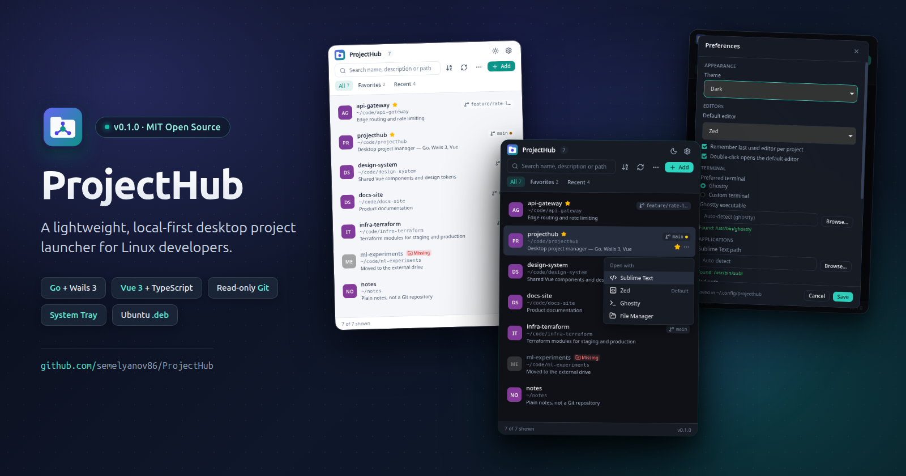

<!--
  SEO & OpenGraph Meta Tags Reference (copy the block matching your blog language)

  [RU]
  <title>ProjectHub: лёгкий локальный лаунчер проектов для Linux-разработчиков</title>
  <meta name="description" content="ProjectHub — бесплатный open-source лаунчер проектов для Ubuntu/GNOME на Go, Wails 3 и Vue 3. Быстрый запуск в Zed, Sublime Text или Ghostty, статус Git, системный трей и никаких облаков.">
  <meta name="keywords" content="ProjectHub, лаунчер проектов Linux, менеджер проектов Ubuntu, аналог JetBrains Toolbox, Zed, Sublime Text, Ghostty, Go, Wails 3, Vue 3, open source">
  <meta property="og:title" content="ProjectHub: лёгкий локальный лаунчер проектов для Linux-разработчиков">
  <meta property="og:description" content="Открывайте локальные репозитории в один клик в редакторе, терминале или файловом менеджере. Безопасный read-only Git-статус, трей и хранение в обычном JSON.">
  <meta property="og:image" content="projecthub-cover.png">

  [EN]
  <title>ProjectHub: A Lightweight, Local-First Project Launcher for Linux Developers</title>
  <meta name="description" content="ProjectHub is an open-source desktop project launcher for Ubuntu/GNOME built with Go, Wails 3, and Vue 3. Open repositories in Zed, Sublime Text, or Ghostty in one click with read-only Git status and system tray integration.">
  <meta name="keywords" content="ProjectHub, Linux project launcher, Ubuntu developer tool, JetBrains Toolbox alternative, Zed, Sublime Text, Ghostty, Go, Wails 3, Vue 3, local-first, open source">
  <meta property="og:title" content="ProjectHub: A Lightweight, Local-First Project Launcher for Linux Developers">
  <meta property="og:description" content="Launch local repositories in one click into your editor, terminal, or file manager. Read-only Git status, system tray, and two plain JSON files—no cloud or telemetry.">
  <meta property="og:image" content="projecthub-cover.png">

  [DE]
  <title>ProjectHub: Ein leichtgewichtiger, lokaler Projekt-Launcher für Linux-Entwickler</title>
  <meta name="description" content="ProjectHub ist ein Open-Source-Projekt-Launcher für Ubuntu/GNOME auf Basis von Go, Wails 3 und Vue 3. Repositories mit einem Klick in Zed, Sublime Text oder Ghostty öffnen – inklusive Read-Only-Git-Status und System-Tray.">
  <meta name="keywords" content="ProjectHub, Linux Projekt-Launcher, Ubuntu Entwickler-Tool, JetBrains Toolbox Alternative, Zed, Sublime Text, Ghostty, Go, Wails 3, Vue 3, Open Source">
  <meta property="og:title" content="ProjectHub: Ein leichtgewichtiger, lokaler Projekt-Launcher für Linux-Entwickler">
  <meta property="og:description" content="Lokale Projekte mit einem Klick im Editor, Terminal oder Dateimanager starten. Read-Only-Git-Status, System-Tray und reine JSON-Konfiguration ohne Cloud oder Telemetrie.">
  <meta property="og:image" content="projecthub-cover.png">
-->



**Язык / Language / Sprache:** [Русский](#русский) · [English](#english) · [Deutsch](#deutsch)

---

<a id="русский"></a>

# [RU] ProjectHub: лёгкий локальный лаунчер проектов для Linux-разработчиков

> **Мета-теги (RU):**
> - **Title:** `ProjectHub: лёгкий локальный лаунчер проектов для Linux-разработчиков`
> - **Description:** `ProjectHub — открытый локальный лаунчер проектов для Ubuntu и GNOME на Go, Wails 3 и Vue 3. Запуск в Zed, Sublime Text или Ghostty в один клик, read-only статус Git и системный трей.`
> - **Keywords:** `ProjectHub`, `лаунчер проектов Linux`, `менеджер проектов Ubuntu`, `аналог JetBrains Toolbox`, `Zed`, `Sublime Text`, `Ghostty`, `Go`, `Wails 3`, `Vue 3`, `open source`

Если в течение дня вы постоянно переключаетесь между несколькими репозиториями, знакомый сценарий повторяется десятки раз: открыть терминал или файловый менеджер, вспомнить, в какой директории лежит нужный сервис, перейти туда и запустить редактор.

У пользователей IDE от JetBrains для этого давно есть удобная вкладка **Projects** в JetBrains Toolbox. Но если вы перешли на лёгкие редакторы вроде **Zed** или **Sublime Text** и терминал **Ghostty** на Linux, аналогичного простого, независимого от конкретной IDE лаунчера под рукой часто не хватает.

Именно поэтому я сделал **[ProjectHub](https://github.com/semelyanov86/ProjectHub)** — небольшое, быстрое и полностью локальное десктоп-приложение для Linux (Ubuntu 24.04 LTS / 26.04 LTS, GNOME), которое держит все ваши проекты на расстоянии одного клика или пункта меню в трее.

## Главная идея: простота и local-first

ProjectHub не пытается заменить вашу IDE, файловый менеджер или Git-клиент. Он не требует аккаунтов, не синхронизируется с облаком и не собирает телеметрию. Вся конфигурация и каталог проектов хранятся локально в двух обычных JSON-файлах по стандарту XDG (`~/.config/projecthub/projects.json` и `settings.json`).

## Что умеет ProjectHub (v0.1.0)

- **Каталог проектов в один клик.** Добавляйте папки вручную или перетаскивайте их прямо в окно (Drag & Drop — можно сразу по несколько штук). Для каждого проекта можно задать имя, описание, флаг «Избранное» и персональный редактор по умолчанию. Удаление проекта из списка никогда не затрагивает файлы на диске.
- **Гибкий запуск инструментов.** Из коробки поддерживаются **Zed** и **Sublime Text**, терминал **Ghostty** (включая открытие новых окон в существующем процессе для версии 1.3+) или любой другой терминал по настраиваемому шаблону аргументов (встроены пресеты для Ptyxis, GNOME Terminal, kitty, Alacritty, WezTerm и Konsole), а также системный файловый менеджер (`gio open` / `xdg-open` или ваш собственный).
- **Статус Git без лишних рисков.** В списке сразу видны текущая ветка (или короткий хэш при detached HEAD), индикатор незафиксированных изменений в отслеживаемых файлах, счётчики ahead/behind во всплывающей подсказке и метка `Missing`, если папка больше не существует.
- **Избранное, недавние и быстрый поиск.** Вкладки **All**, **Favorites** и **Recent**, поиск по названию, описанию и пути (`Ctrl+F`), сортировка по имени или времени последнего открытия и полноценная навигация с клавиатуры (`↑`/`↓`, `Enter`, `Ctrl+Enter`, `F2`, `Delete`).
- **Системный трей и единый экземпляр.** Через StatusNotifierItem-трей (например, со стандартным расширением Ubuntu AppIndicators) можно быстро открыть один из 8 последних проектов или вернуть окно. При закрытии окно сворачивается в трей (поведение настраивается), а если трея в системе нет — приложение корректно завершается. Повторный запуск `projecthub` просто поднимает уже открытое окно.
- **Импорт и экспорт в JSON.** Переносите список проектов на другую машину с предпросмотром новых, дублирующихся и отсутствующих путей — в режиме слияния или полной замены (с автоматическим бэкапом предыдущего `projects.json`).
- **Светлая, тёмная и системная темы**, запоминание размера окна и опция «поверх всех окон».

## Как это устроено внутри

В основе ProjectHub — стек **Go 1.26+**, **Wails 3** (GTK 4 + WebKitGTK 6.0) и **Vue 3** (`<script setup lang="ts">`, строгий TypeScript, Tailwind CSS v4, Pinia):

- **Чёткое разделение ответственности.** Весь доступ к файловой системе, процессам, нативным диалогам и Git-инспекции сосредоточен на стороне Go. Фронтенд общается с бэкендом только через типизированные биндинги Wails по ID проекта и не передаёт пути к файлам для чтения или записи.
- **Безопасный запуск без shell-инъекций.** Внешние приложения запускаются строго через `exec.Command` с раздельными аргументами — никакого `sh -c` или `bash -c`, даже если в пути проекта есть пробелы или спецсимволы.
- **Безопасная read-only инспекция Git.** Проверка репозиториев ограничена по времени (3 секунды на репозиторий) и параллелизму (до 4 процессов), не делает сетевых запросов, очищает унаследованные переменные `GIT_*` и принудительно отключает `core.fsmonitor` и фильтры из конфигурации репозитория, чтобы случайное открытие чужого проекта не могло выполнить произвольный код.
- **Атомарная запись конфигурации.** Файлы пишутся через временный файл с `fsync`, переименованием и синхронизацией директории с правами `0600`. Повреждённый JSON никогда не перезаписывается молча — пользователь получает понятное сообщение об ошибке.

## Попробуйте и установите ProjectHub

Проект распространяется под лицензией **MIT** в виде `.deb`-пакета для Ubuntu 24.04 LTS и Ubuntu 26.04 LTS (`amd64`), а также легко собирается из исходников с помощью `task`.

👉 **Репозиторий и исходный код:** [github.com/semelyanov86/ProjectHub](https://github.com/semelyanov86/ProjectHub)  
📦 **Скачать последний релиз (`.deb` + `SHA256SUMS`):** [github.com/semelyanov86/ProjectHub/releases/latest](https://github.com/semelyanov86/ProjectHub/releases/latest)

Установка на Ubuntu:

```bash
sha256sum --check --ignore-missing SHA256SUMS
sudo apt install ./projecthub_*_amd64.deb
```

После установки **ProjectHub** появится в меню приложений GNOME и поиске, его можно закрепить в доке, а все настройки всегда останутся под вашим контролем в `~/.config/projecthub`. Буду рад звёздам на GitHub, отзывам, баг-репортам и пул-реквестам!

---

<a id="english"></a>

# [EN] ProjectHub: A Lightweight, Local-First Project Launcher for Linux Developers

> **Meta tags (EN):**
> - **Title:** `ProjectHub: A Lightweight, Local-First Project Launcher for Linux Developers`
> - **Description:** `ProjectHub is an open-source desktop project launcher for Ubuntu and GNOME built with Go, Wails 3, and Vue 3. Open repositories in Zed, Sublime Text, or Ghostty in one click with read-only Git status and system tray integration.`
> - **Keywords:** `ProjectHub`, `Linux project launcher`, `Ubuntu developer tool`, `JetBrains Toolbox alternative`, `Zed`, `Sublime Text`, `Ghostty`, `Go`, `Wails 3`, `Vue 3`, `local-first`, `open source`

If you switch between several repositories throughout the day, you know the routine: open a terminal or file picker, remember where that particular service lives, navigate there, and launch your editor.

JetBrains users have long appreciated the **Projects** view in JetBrains Toolbox for solving this friction. But if your daily toolkit on Linux revolves around fast, standalone tools like **Zed**, **Sublime Text**, and **Ghostty**, there hasn't been a clean, editor-agnostic equivalent that stays out of your way.

That is why I built **[ProjectHub](https://github.com/semelyanov86/ProjectHub)** — a lightweight, local-first desktop project launcher for Linux (Ubuntu 24.04 LTS / 26.04 LTS, GNOME) that keeps every local repository one click or one tray menu item away.

## Philosophy: Local-First and Focused

ProjectHub doesn't try to replace your editor, terminal, or Git client. There are no user accounts, no cloud sync, and no telemetry. Your entire catalog and configuration live locally in two plain, XDG-compliant JSON files (`~/.config/projecthub/projects.json` and `settings.json`).

## Key Features (v0.1.0)

- **One-click project catalog.** Add folders via the native picker or drag and drop directories straight onto the window (single or batch). Give each project a custom name, description, favorite star, and optional per-project default editor. Removing a project only unregisters it—never touching files on disk.
- **Open with your favorite tools.** Supports **Zed** and **Sublime Text**, **Ghostty** (using single-instance `+new-window` on 1.3+ with automatic fallback) or any custom terminal via argument templates (with presets for Ptyxis, GNOME Terminal, kitty, Alacritty, WezTerm, and Konsole), plus your system file manager (`gio open` / `xdg-open` or a custom executable).
- **Read-only Git status at a glance.** See the current branch (or short commit hash on detached HEAD), a dot for uncommitted tracked changes, ahead/behind counts in the tooltip, and a clear `Missing` badge when a folder no longer exists.
- **Favorites, Recent, search & keyboard workflow.** Switch between **All**, **Favorites**, and **Recent**, filter instantly by name, description, or path (`Ctrl+F`), sort by name or last opened, and navigate with the keyboard (`↑`/`↓`, `Enter`, `Ctrl+Enter`, `F2`, `Delete`).
- **System tray & single instance.** Jump straight into your 8 most recently opened projects from the StatusNotifierItem tray menu (supported out of the box on Ubuntu via AppIndicators). Closing the window minimizes to the tray when a tray host is available, or cleanly quits when there isn't one. Launching `projecthub` a second time brings the existing window back into focus.
- **JSON import & export.** Move your catalog between machines with a full preview of new, duplicate, and missing paths—choosing either **Merge** or **Replace** (which saves a timestamped backup of your existing `projects.json`).
- **Light, dark, and system themes**, remembered window dimensions, and an optional always-on-top mode.

## Under the Hood

ProjectHub is built with **Go 1.26+**, **Wails 3** (GTK 4 + WebKitGTK 6.0), and **Vue 3** (`<script setup lang="ts">`, strict TypeScript, Tailwind CSS v4, and Pinia):

- **Strict separation of concerns.** The Go backend owns all filesystem, process, dialog, and Git operations. The Vue frontend communicates exclusively through typed Wails bindings by project ID and never passes raw filesystem paths to read or write.
- **No shell injection.** External applications are spawned directly with `exec.Command` and discrete argument slices—never through `sh -c` or `bash -c`, safely handling spaces and special characters in directory paths.
- **Hardened, read-only Git inspection.** Status checks are concurrency-bounded (up to 4 workers) and time-limited (3 seconds per repository), never fetch over the network, sanitize inherited `GIT_*` environment variables, and disable `core.fsmonitor` and repository-defined filter drivers so inspecting an untrusted repo cannot execute arbitrary hooks.
- **Atomic config persistence.** JSON files are written with `0600` permissions via a temp file, `fsync`, atomic rename, and directory `fsync`. Corrupted config files are surfaced with an actionable error instead of being silently overwritten.

## Try & Install ProjectHub

ProjectHub is open source under the **MIT License**, distributed as a `.deb` package for Ubuntu 24.04 LTS and 26.04 LTS (`amd64`), and easy to build from source with `task`.

👉 **GitHub Repository:** [github.com/semelyanov86/ProjectHub](https://github.com/semelyanov86/ProjectHub)  
📦 **Download Latest Release (`.deb` + `SHA256SUMS`):** [github.com/semelyanov86/ProjectHub/releases/latest](https://github.com/semelyanov86/ProjectHub/releases/latest)

Install on Ubuntu:

```bash
sha256sum --check --ignore-missing SHA256SUMS
sudo apt install ./projecthub_*_amd64.deb
```

Once installed, launch **ProjectHub** from your GNOME applications menu or pin it to your dock. Give it a try—feedback, issues, stars, and pull requests on GitHub are very welcome!

---

<a id="deutsch"></a>

# [DE] ProjectHub: Ein leichtgewichtiger, lokaler Projekt-Launcher für Linux-Entwickler

> **Meta-Tags (DE):**
> - **Title:** `ProjectHub: Ein leichtgewichtiger, lokaler Projekt-Launcher für Linux-Entwickler`
> - **Description:** `ProjectHub ist ein Open-Source-Projekt-Launcher für Ubuntu und GNOME auf Basis von Go, Wails 3 und Vue 3. Projekte mit einem Klick in Zed, Sublime Text oder Ghostty öffnen – mit Read-Only-Git-Status und System-Tray.`
> - **Keywords:** `ProjectHub`, `Linux Projekt-Launcher`, `Ubuntu Entwickler-Tool`, `JetBrains Toolbox Alternative`, `Zed`, `Sublime Text`, `Ghostty`, `Go`, `Wails 3`, `Vue 3`, `Open Source`

Wer im Arbeitsalltag ständig zwischen mehreren Repositories wechselt, kennt den Ablauf: Terminal oder Dateiauswahl öffnen, überlegen, wo das jeweilige Projekt liegt, dorthin navigieren und schließlich den Editor starten.

Nutzer von JetBrains-IDEs schätzen dafür seit Jahren die **Projects**-Ansicht der JetBrains Toolbox. Wer unter Linux jedoch lieber auf schnelle, schlanke Werkzeuge wie **Zed**, **Sublime Text** und **Ghostty** setzt, vermisst oft genau so einen kompakten, IDE-unabhängigen Projekt-Launcher.

Deshalb habe ich **[ProjectHub](https://github.com/semelyanov86/ProjectHub)** entwickelt: eine schlanke, konsequent lokale Desktop-Anwendung für Linux (Ubuntu 24.04 LTS / 26.04 LTS, GNOME), mit der jedes lokale Projekt nur einen Klick oder einen Eintrag im System-Tray entfernt ist.

## Philosophie: Local-First ohne Ballast

ProjectHub will weder Ihren Editor noch Ihr Terminal oder Ihren Git-Client ersetzen. Es gibt keine Benutzerkonten, keine Cloud-Synchronisation und keine Telemetrie. Der komplette Katalog und alle Einstellungen liegen lokal in zwei übersichtlichen JSON-Dateien gemäß XDG-Standard (`~/.config/projecthub/projects.json` und `settings.json`).

## Wichtige Funktionen (v0.1.0)

- **Projektkatalog auf einen Klick.** Ordner lassen sich über den nativen Auswahldialog hinzufügen oder direkt per Drag & Drop ins Fenster ziehen (einzeln oder mehrere gleichzeitig). Jedes Projekt kann mit Name, Beschreibung, Favoriten-Stern und eigenem Standard-Editor versehen werden. Das Entfernen aus der Liste löscht niemals Dateien auf der Festplatte.
- **Nahtloses Öffnen mit Ihren Tools.** Unterstützt **Zed** und **Sublime Text**, **Ghostty** (inklusive `+new-window` ab Version 1.3 mit Fallback) oder jedes beliebige Terminal per Argument-Vorlage (mit Presets für Ptyxis, GNOME Terminal, kitty, Alacritty, WezTerm und Konsole) sowie den System-Dateimanager (`gio open` / `xdg-open` oder ein eigenes Programm).
- **Read-Only-Git-Status auf einen Blick.** Zeigt direkt den aktuellen Branch (oder den kurzen Commit-Hash bei Detached HEAD), einen Indikator für uncommittete Änderungen an getrackten Dateien, Ahead/Behind-Zähler im Tooltip sowie eine `Missing`-Markierung, falls ein Verzeichnis nicht mehr existiert.
- **Favoriten, Zuletzt geöffnet, Suche & Tastatursteuerung.** Tabs für **All**, **Favorites** und **Recent**, Sofortsuche nach Name, Beschreibung oder Pfad (`Ctrl+F`), Sortierung nach Name oder letztem Öffnen sowie durchgängige Tastaturbedienung (`↑`/`↓`, `Enter`, `Ctrl+Enter`, `F2`, `Delete`).
- **System-Tray & Single Instance.** Über das StatusNotifierItem-Tray-Menü (unter Ubuntu standardmäßig über *Ubuntu AppIndicators* verfügbar) starten Sie direkt eines der letzten acht Projekte. Beim Schließen minimiert sich ProjectHub standardmäßig in den Tray – fehlt ein Tray-Host, beendet sich die App sauber. Ein erneuter Start von `projecthub` holt das laufende Fenster wieder in den Vordergrund.
- **JSON-Import und -Export.** Übertragen Sie Ihren Projektkatalog inklusive Vorschau neuer, doppelter und fehlender Pfade auf andere Rechner – wahlweise per **Merge** oder **Replace** (mit automatischem Backup der vorherigen `projects.json`).
- **Helles, dunkles und System-Theme**, gemerkte Fenstergröße und optionales *Always on top*.

## Ein Blick unter die Haube

Technisch basiert ProjectHub auf **Go 1.26+**, **Wails 3** (GTK 4 + WebKitGTK 6.0) und **Vue 3** (`<script setup lang="ts">`, striktes TypeScript, Tailwind CSS v4, Pinia):

- **Klare Trennung von Backend und UI.** Sämtliche Datei-, Prozess-, Dialog- und Git-Operationen laufen im Go-Backend. Das Vue-Frontend kommuniziert ausschließlich über typisierte Wails-Bindings anhand von Projekt-IDs und übergibt niemals Dateipfade zum Lesen oder Schreiben.
- **Sichere Prozessstarts ohne Shell.** Externe Programme werden strikt über `exec.Command` mit einzelnen Argumenten gestartet – niemals über `sh -c` oder `bash -c`, sodass auch Leer- und Sonderzeichen in Pfaden sicher verarbeitet werden.
- **Abgesicherte Read-Only-Git-Prüfung.** Die Git-Abfrage ist auf maximal 4 parallele Prozesse und 3 Sekunden Timeout pro Repository begrenzt, führt niemals Netzwerk-Fetches aus, bereinigt geerbte `GIT_*`-Umgebungsvariablen und deaktiviert `core.fsmonitor` sowie Repository-Filtertreiber, damit beim Prüfen fremder Repos kein Code ausgeführt werden kann.
- **Atomares Speichern.** Konfigurationsdateien werden mit Rechten `0600` über eine temporäre Datei, `fsync`, atomares Umbenennen und Verzeichnis-`fsync` geschrieben. Beschädigte JSON-Dateien werden gemeldet und niemals stillschweigend überschrieben.

## Jetzt ausprobieren und installieren

ProjectHub steht unter der **MIT-Lizenz** als fertiges `.deb`-Paket für Ubuntu 24.04 LTS und 26.04 LTS (`amd64`) bereit und lässt sich auch unkompliziert mit `task` selbst bauen.

👉 **GitHub-Repository:** [github.com/semelyanov86/ProjectHub](https://github.com/semelyanov86/ProjectHub)  
📦 **Aktuelles Release herunterladen (`.deb` + `SHA256SUMS`):** [github.com/semelyanov86/ProjectHub/releases/latest](https://github.com/semelyanov86/ProjectHub/releases/latest)

Installation unter Ubuntu:

```bash
sha256sum --check --ignore-missing SHA256SUMS
sudo apt install ./projecthub_*_amd64.deb
```

Nach der Installation erscheint **ProjectHub** direkt im GNOME-Anwendungsmenü und lässt sich ans Dock anheften. Probieren Sie es gerne aus — über Feedback, Issues, Stars oder Pull Requests auf GitHub freue ich mich sehr!
